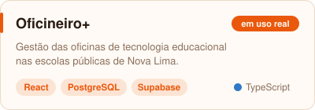
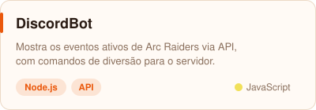
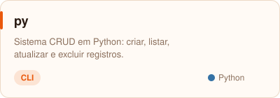
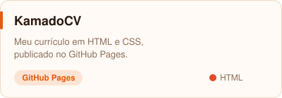
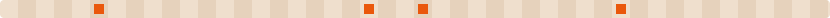

<picture>
  <source media="(prefers-color-scheme: dark)" srcset="assets/banner-dark.svg">
  
</picture>

<p align="center">
  <a href="https://kamadoo.github.io/KamadoCV/"></a>
  <a href="https://www.linkedin.com/in/jo%C3%A3o-vitor-nunes-02a679268/"></a>
  <a href="https://x.com/kamadocoding"></a>
</p>

## 🔥 Sobre mim

```js
const kamado = {
  nome:      "João Vitor Nunes",
  trabalho:  "Desenvolvedor @ Arlequim (remoto)",
  estudo:    "Análise e Desenvolvimento de Sistemas · PUCPR",
  construo:  ["sites", "aplicativos", "mundos no Minecraft Education"],
  idiomas:   ["Português", "Inglês (avançado)"],
  desde:     "mexendo com computadores desde os 14 anos",
};
```

<details>
<summary><b>🇺🇸 In English</b></summary>
<br>

I'm a developer at **Arlequim** and an Analysis & Systems Development student at **PUCPR** (Brazil). I build websites and apps, design educational worlds in **Minecraft Education**, and created **Oficineiro+**, a web app that supports the technology workshops in the public schools of Nova Lima. Always learning something new.

</details>

## 🧰 Ferramentas

<p align="center">
  <br>
  
</p>

## 🛠️ Projetos

<p align="center">
  <a href="https://github.com/Kamadoo/oficineiro-mais"><picture><source media="(prefers-color-scheme: dark)" srcset="assets/card-oficineiro-dark.svg"></picture></a>
  <a href="https://github.com/Kamadoo/DiscordBot"><picture><source media="(prefers-color-scheme: dark)" srcset="assets/card-discordbot-dark.svg"></picture></a>
  <a href="https://github.com/Kamadoo/py"><picture><source media="(prefers-color-scheme: dark)" srcset="assets/card-py-dark.svg"></picture></a>
  <a href="https://github.com/Kamadoo/KamadoCV"><picture><source media="(prefers-color-scheme: dark)" srcset="assets/card-kamadocv-dark.svg"></picture></a>
</p>

<details>
<summary><b>🧱 Em desenvolvimento</b></summary>
<br>

- Uma rede social simples
- Uma API com front-end próprio

</details>

## 🐍 Atividade

<picture>
  <source media="(prefers-color-scheme: dark)" srcset="https://raw.githubusercontent.com/Kamadoo/Kamadoo/output/snake-dark.svg">
  
</picture>

<br>

<picture>
  <source media="(prefers-color-scheme: dark)" srcset="assets/divider-dark.svg">
  
</picture>

<p align="center"><sub>feito à mão, no fogo baixo 🔥</sub></p>
